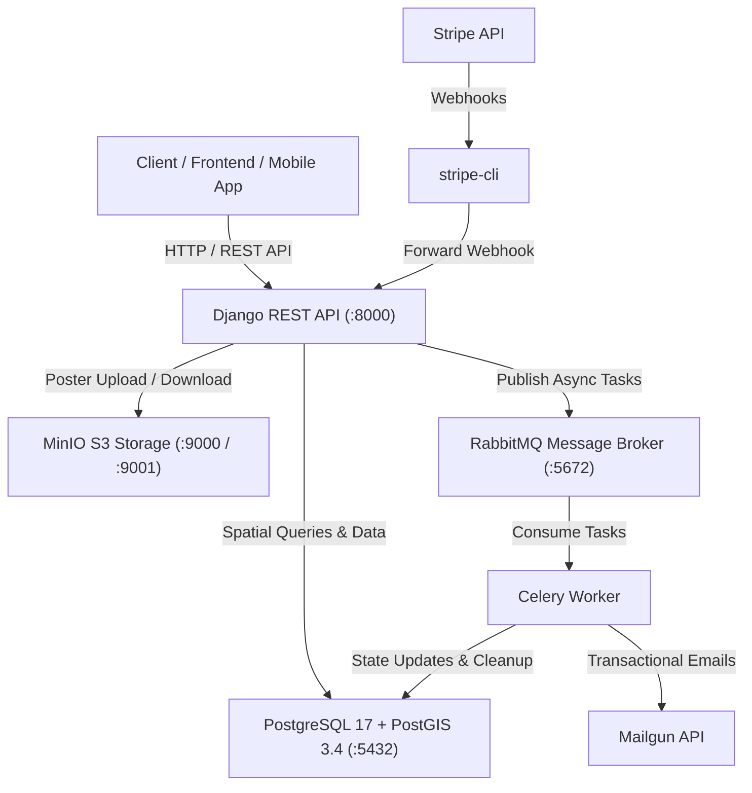

# 🎬 Movie Reservation System (Californication Cinema API)

[](https://www.python.org/)
[](https://www.djangoproject.com/)
[](https://www.django-rest-framework.org/)
[](https://www.postgresql.org/)
[](https://postgis.net/)
[](https://docs.celeryq.dev/)
[](https://www.rabbitmq.com/)
[](https://min.io/)
[](https://stripe.com/)
[](https://www.docker.com/)

A modern, high-performance, asynchronous RESTful API for cinema ticket reservation and theater management. Built with **Django**, **Django REST Framework**, and **PostGIS**, featuring atomic concurrency control for seat reservations, asynchronous background processing with **Celery** and **RabbitMQ**, **Stripe** payment processing with webhooks, S3-compatible media storage via **MinIO**, and automated email notifications powered by **Mailgun**.

---

## 📋 Table of Contents

- [Key Features](#-key-features)
- [System Architecture](#-system-architecture)
- [Tech Stack](#-tech-stack)
- [Project Directory Structure](#-project-directory-structure)
- [Environment Variables](#-environment-variables)
- [Quick Start with Docker Compose](#-quick-start-with-docker-compose-recommended)
- [Manual Local Setup](#-manual-local-setup)
- [API Endpoints Reference](#-api-endpoints-reference)
  - [Authentication & Users](#1-authentication--users)
  - [Cinemas & Geolocation](#2-cinemas--geolocation)
  - [Movies & Reviews](#3-movies--reviews)
  - [Showtimes & Seating](#4-showtimes--seating)
  - [Reservations & Payments](#5-reservations--payments)
  - [Admin Analytics & Reports](#6-admin-analytics--reports)
- [Asynchronous Background Tasks](#-asynchronous-background-tasks)
- [Concurrency & Race Condition Handling](#-concurrency--race-condition-handling)

---

## 🚀 Key Features

- **🔐 Robust User & Auth Management**:
  - Custom user model (`CustomUser`) with JWT authentication (`access` and `refresh` tokens).
  - Secure email verification flow with signed activation links via Mailgun.
  - Role-based access control (Admin vs. Customer).

- **🗺️ Geolocation & Cinema Mapping**:
  - Powered by **PostGIS** spatial coordinates (`PointField`).
  - GeoJSON endpoint (`/api/cinemas/map/`) for interactive maps.
  - Filter cinemas by showing movie title or ID.

- **🍿 Movie Catalog & Reviews**:
  - Movie metadata with genres, ratings, and media poster storage on MinIO (S3 API).
  - Real-time rating aggregation computed dynamically from user reviews (`Avg('reviews__grade')`).
  - Interactive movie detail view with showtimes and user reviews.

- **🎟️ Hall Seating & Concurrency-Safe Booking**:
  - Seat layout by hall with row and seat numbers.
  - **Zero Overbooking Guarantee**: Atomic transactions (`transaction.atomic`) combined with pessimistic row-level locking (`select_for_update`) to eliminate race conditions during simultaneous seat selection.
  - Real-time endpoint checking available vacant seats for any showtime.

- **⏱️ Automated Task Scheduling**:
  - **15-Minute Expiration Timer**: Unpaid bookings are automatically cancelled by a Celery task after 15 minutes (`countdown=900`), releasing seats back to the public.
  - **Showtime Cleanup**: Completed showtimes and outdated records are automatically purged 1 hour after the screening ends.

- **💳 Stripe Payment & Webhook Integration**:
  - Secure payment processing using Stripe Payment Intents.
  - Real-time webhook listener (`/api/webhook/stripe/`) verifying Stripe cryptographic signatures for asynchronous booking confirmations.
  - Pre-configured `stripe-cli` container in Docker Compose for seamless local development webhook forwarding.

- **📊 Comprehensive Admin Analytics**:
  - Movie revenue reports: total tickets sold, aggregate revenue, and per-movie rankings.
  - Showtime analytics: hall occupancy rate (`hall_load %`), available seats, and generated revenue.

---

## 🏗️ System Architecture



---

## 🛠️ Tech Stack

| Technology | Purpose |
| :--- | :--- |
| **Python 3.12** | Core programming language |
| **Django 6.1** | High-level web framework |
| **Django REST Framework (DRF) 3.18** | RESTful API toolkit |
| **djangorestframework-simplejwt** | JSON Web Token (JWT) authentication |
| **PostgreSQL 17 + PostGIS 3.4** | Relational database with geospatial extensions |
| **GeoDjango & djangorestframework-gis**| Geospatial data serialization & queries |
| **Celery 5.6** | Distributed asynchronous task queue |
| **RabbitMQ 3 (Management)** | Message broker for Celery |
| **MinIO** | High-performance S3-compatible object storage for movie posters |
| **django-storages & boto3** | AWS S3 / MinIO storage backend integration |
| **Stripe Python SDK 15.5** | Payment Intent creation and checkout |
| **Stripe CLI** | Local webhook event forwarding |
| **Mailgun REST API** | Transactional email delivery (activation & receipts) |
| **Docker & Docker Compose** | Multi-container environment orchestration |

---

## 📁 Project Directory Structure

```text
Movie Reservation System/
├── cinema_config/             # Django project configuration
│   ├── asgi.py
│   ├── celery.py              # Celery instance configuration
│   ├── settings.py            # Global settings (DB, S3, Celery, Stripe, etc.)
│   ├── urls.py                # Main URL routing
│   └── wsgi.py
├── cinemas/                   # Cinemas & Hall locations app
│   ├── admin.py
│   ├── models.py              # Cinema model with PostGIS PointField
│   ├── permissions.py         # IsAdminOrReadOnly permission
│   ├── serializers.py         # GeoJSON and Cinema serializers
│   ├── urls.py
│   └── views.py               # CinemaViewSet & GeoJSON map endpoint
├── movies/                    # Movies, Showtimes & Reviews app
│   ├── admin.py
│   ├── models.py              # Movie, Genre, Hall, Seat, Showtime, Review
│   ├── permissions.py
│   ├── serializers.py
│   ├── tasks.py               # Celery task for showtime cleanup
│   ├── urls.py
│   └── views.py               # MovieViewSet, ShowtimeViewSet, Admin Reports
├── reservations/              # Bookings & Payments app
│   ├── admin.py
│   ├── models.py              # Reservation, Payment
│   ├── serializers.py         # Safe seat booking serializer
│   ├── tasks.py               # Celery auto-cancel & email receipt tasks
│   ├── urls.py
│   ├── views.py               # ReservationViewSet, Stripe pay action
│   └── webhooks.py            # Stripe webhook endpoint
├── users/                     # Custom User & Authentication app
│   ├── admin.py
│   ├── models.py              # CustomUser model
│   ├── serializers.py         # Register & Profile serializers
│   ├── tasks.py               # Celery task for email verification
│   ├── urls.py
│   └── views.py               # RegisterView, VerifyEmailView, UserProfileView
├── compose.yaml               # Docker Compose multi-service setup
├── Dockerfile                 # Multi-stage production/dev Dockerfile
├── requirements.txt           # Python dependencies
├── .env.example               # Environment variables template
└── manage.py                  # Django management script
```

---

## ⚙️ Environment Variables

Create a `.env` file in the project root by copying `.env.example`:

```bash
cp .env.example .env
```

| Variable | Description | Example / Default |
| :--- | :--- | :--- |
| `SECRET_KEY` | Django secret key | `django-insecure-...` |
| `DEBUG` | Enable/disable debug mode | `True` or `False` |
| `DJANGO_ALLOWED_HOSTS` | Comma-separated allowed hosts | `127.0.0.1,localhost,backend` |
| `POSTGRES_DB_NAME` | PostgreSQL database name | `cinema_db` |
| `POSTGRES_DB_USER` | PostgreSQL username | `postgres` |
| `POSTGRES_DB_PASSWORD` | PostgreSQL password | `postgres_password` |
| `POSTGRES_DB_HOST` | Database host (`postgres` for Docker, `localhost` for local) | `postgres` |
| `RABBITMQ_USER` | RabbitMQ username | `guest` |
| `RABBITMQ_PASSWORD` | RabbitMQ password | `guest` |
| `MINIO_ROOT_USER` | MinIO root access key | `minioadmin` |
| `MINIO_ROOT_PASSWORD` | MinIO root secret key | `minioadmin` |
| `AWS_STORAGE_BUCKET_NAME`| S3 Bucket name for media files | `cinema-media` |
| `AWS_S3_ENDPOINT_URL` | MinIO endpoint URL | `http://minio:9000` |
| `STRIPE_API_KEY` | Stripe secret key | `sk_test_...` |
| `STRIPE_WEBHOOK_SECRET` | Stripe webhook signing secret | `whsec_...` |
| `MAILGUN_API_KEY` | Mailgun API key | `key-...` |
| `MAILGUN_DOMAIN` | Mailgun sending domain | `sandboxXYZ.mailgun.org` |
| `MAILGUN_BASE_URL` | Mailgun base API URL | `https://api.mailgun.net` |

---

## 🐳 Quick Start with Docker Compose (Recommended)

The easiest way to run the entire stack (Django, PostGIS, RabbitMQ, Celery, MinIO, Stripe CLI) is with Docker Compose.

### 1. Clone the repository & enter the directory
```bash
git clone <repository-url>
cd "Movie Reservation System"
```

### 2. Configure environment variables
```bash
cp .env.example .env
# Fill in your Stripe, Mailgun, and secret keys in .env
```

### 3. Build and launch the containers
```bash
docker compose up --build
```

The services will initialize:
- **Django Backend**: Automatically runs migrations and starts at [http://localhost:8000](http://localhost:8000)
- **PostgreSQL / PostGIS**: Running on port `5432`
- **RabbitMQ Management Console**: [http://localhost:15672](http://localhost:15672) (User/Password from `.env`)
- **MinIO Storage & Console**:
  - API: [http://localhost:9000](http://localhost:9000)
  - Web Console: [http://localhost:9001](http://localhost:9001)
  - *`minio-client` automatically creates the media bucket and sets public read permissions!*
- **Celery Worker**: Listens to RabbitMQ queues for asynchronous emails & cleanup tasks.
- **Stripe CLI**: Listens and forwards webhook events to `/api/webhook/stripe/`.

### 4. Create a Superuser
```bash
docker compose exec backend python manage.py createsuperuser
```

---

## 💻 Manual Local Setup

If you wish to run the project without Docker:

### Prerequisites
- Python 3.12
- PostgreSQL 17 with PostGIS extension installed
- GDAL and GEOS libraries (required by GeoDjango)
- RabbitMQ server running
- MinIO server running

### Steps

1. **Create and activate a virtual environment**:
   ```bash
   python -m venv .venv
   # Windows (PowerShell):
   .venv\Scripts\Activate.ps1
   # Linux/macOS:
   source .venv/bin/activate
   ```

2. **Install dependencies**:
   ```bash
   pip install -r requirements.txt
   ```

3. **Configure environment**:
   Make sure `.env` has `POSTGRES_DB_HOST=localhost` and `AWS_S3_ENDPOINT_URL=http://localhost:9000`.

4. **Run database migrations**:
   ```bash
   python manage.py makemigrations
   python manage.py migrate
   ```

5. **Start Celery worker**:
   ```bash
   # On Linux/macOS:
   celery -A cinema_config worker --loglevel=info
   # On Windows:
   celery -A cinema_config worker --loglevel=info -P solo
   ```

6. **Start the Django development server**:
   ```bash
   python manage.py runserver
   ```

---

## 📡 API Endpoints Reference

All API routes are prefixed with `/api/`.

### 1. Authentication & Users

| Method | Endpoint | Access | Description |
| :--- | :--- | :--- | :--- |
| `POST` | `/api/register/` | Public | Register new user; queues verification email |
| `GET` | `/api/verify/<uidb64>/<token>/` | Public | Verify email token and activate user account |
| `POST` | `/api/token/` | Public | Obtain JWT `access` and `refresh` tokens |
| `POST` | `/api/token/refresh/` | Public | Refresh JWT access token |
| `GET` | `/api/me/` | Authenticated | Retrieve current user profile |

#### Example: Register User
```http
POST /api/register/
Content-Type: application/json

{
  "username": "johndoe",
  "email": "johndoe@example.com",
  "password": "StrongPassword123!"
}
```

---

### 2. Cinemas & Geolocation

| Method | Endpoint | Access | Description |
| :--- | :--- | :--- | :--- |
| `GET` | `/api/cinemas/` | Public | List cinemas. Supports `?movie_id=` and `?movie_name=` |
| `POST` | `/api/cinemas/` | Admin | Create a new cinema location |
| `GET` | `/api/cinemas/<id>/` | Public | Detailed cinema info including halls |
| `PUT/DELETE` | `/api/cinemas/<id>/` | Admin | Update or delete cinema |
| `GET` | `/api/cinemas/map/` | Public | Return all cinemas in **GeoJSON** format |

---

### 3. Movies & Reviews

| Method | Endpoint | Access | Description |
| :--- | :--- | :--- | :--- |
| `GET` | `/api/movies/` | Public | List movies with average rating. Filters: `?genre_id=`, `?cinema_id=` |
| `POST` | `/api/movies/` | Admin | Add a movie with poster upload to MinIO S3 |
| `GET` | `/api/movies/<id>/` | Public | Retrieve single movie details |
| `GET` | `/api/movies/<id>/info/` | Public | Full movie overview with scheduled showtimes and reviews |
| `POST` | `/api/movies/<id>/review/` | Authenticated | Submit movie review and rating (1-10) |

#### Example: Post a Review
```http
POST /api/movies/1/review/
Authorization: Bearer <access_token>
Content-Type: application/json

{
  "grade": 9,
  "comment": "Outstanding cinematography and acting!"
}
```

---

### 4. Showtimes & Seating

| Method | Endpoint | Access | Description |
| :--- | :--- | :--- | :--- |
| `GET` | `/api/showtimes/` | Public | List showtimes. Filters: `?date=YYYY-MM-DD`, `?cinema_id=` |
| `POST` | `/api/showtimes/` | Admin | Create showtime (auto-schedules Celery expiration) |
| `GET` | `/api/showtimes/<id>/` | Public | Show time details |
| `GET` | `/api/showtimes/<id>/available_seats/`| Public | List vacant seats available for booking |

---

### 5. Reservations & Payments

| Method | Endpoint | Access | Description |
| :--- | :--- | :--- | :--- |
| `GET` | `/api/reservations/` | Authenticated | List reservations (Users see their own; Staff sees all) |
| `POST` | `/api/reservations/` | Authenticated | Create a seat reservation (**15-min countdown begins**) |
| `GET` | `/api/reservations/<id>/` | Authenticated | Retrieve reservation details |
| `POST` | `/api/reservations/<id>/pay/` | Authenticated | Pay for reservation via Stripe payment method |
| `GET` | `/api/payments/` | Admin | View payment history |
| `POST` | `/api/webhook/stripe/` | Public (Stripe) | Stripe webhook listener for asynchronous confirmation |

#### Example: Reserve a Seat
```http
POST /api/reservations/
Authorization: Bearer <access_token>
Content-Type: application/json

{
  "showtime": 4,
  "seat": 12
}
```

#### Example: Pay for Reservation
```http
POST /api/reservations/10/pay/
Authorization: Bearer <access_token>
Content-Type: application/json

{
  "payment_method_id": "pm_card_visa"
}
```

---

### 6. Admin Analytics & Reports

| Method | Endpoint | Access | Description |
| :--- | :--- | :--- | :--- |
| `GET` | `/api/reports/movies/` | Admin | Overall cinema revenue and per-movie revenue breakdown |
| `GET` | `/api/reports/movies/<id>/` | Admin | Single movie revenue and tickets sold |
| `GET` | `/api/reports/showtimes/` | Admin | Showtime analytics: total tickets sold, revenue, and hall occupancy (`hall_load %`) |
| `GET` | `/api/reports/showtimes/<id>/` | Admin | Single showtime occupancy and revenue report |

---

## ⚡ Asynchronous Background Tasks

Background processing is executed using Celery workers with RabbitMQ:

1. **`send_verification_email_task`** (`users.tasks`):
   Dispatched on user registration. Generates a cryptographic token and sends an HTML activation email via Mailgun.
2. **`cancel_unpaid_reservation`** (`reservations.tasks`):
   Scheduled with `countdown=900` (15 minutes) when a reservation is placed. If the reservation status is still `pending`, it is cancelled and the seat is released.
3. **`send_reservation_email`** (`reservations.tasks`):
   Dispatched upon successful Stripe payment. Sends a confirmation receipt with movie title, showtime, price, and Stripe transaction ID.
4. **`delete_completed_showtime`** (`movies.tasks`):
   Scheduled with `eta = showtime.end_time + 1 hour`. Once a movie screening has concluded, the showtime record is automatically removed.

---

## 🔒 Concurrency & Race Condition Handling

To guarantee that two users cannot book the same seat simultaneously:

1. **Pessimistic Row-Level Locking**:
   In `ReservationSerializer.create`, `Seat.objects.select_for_update().get(id=seat.id)` locks the target seat row inside an atomic database transaction (`transaction.atomic()`).
2. **Database Unique Constraints**:
   The `Reservation` model defines a database-level composite unique constraint:
   ```python
   class Meta:
       unique_together = ('showtime', 'seat')
   ```
3. **Double-Booking Verification**:
   The reservation query checks for both `pending` and `confirmed` statuses before issuing a reservation.